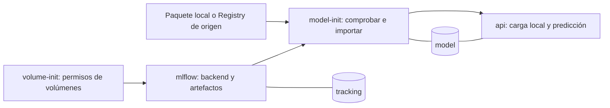

# Operación P1 con Compose y CI/CD

Orquestamos la API y MLflow sin reentrenar el modelo ni guardar sus archivos en Git.
El arranque importa una versión verificada, conserva su procedencia y prepara un
paquete local para que la API atienda peticiones sin depender del Registry en cada consulta.

## Preparación y comando de arranque

Requisitos: Docker Engine/Desktop iniciado y Docker Compose v2. Se necesita una
versión P1 ya entrenada y accesible; un clon de código no contiene el modelo ni el
Registry de otro integrante. Hay dos fuentes posibles:

1. **Paquete local existente:** conservar `models/serving/p1/` con `registry.json` y
   `model/`, generado con `python -m mibici.serving download`. Es el valor predeterminado.
2. **Registry de origen accesible:** configurar `MIBICI_SOURCE_REGISTRY`,
   `MIBICI_SOURCE_MODEL_NAME`, `MIBICI_SOURCE_MODEL_VERSION` y el SHA esperado en
   `.env`, usando [.env.example](../.env.example). El inicializador descarga esa versión
   cuando arranca; no requiere Python ni entrenamiento en el host.

Desde la raíz:

```bash
docker compose up --build -d --wait --wait-timeout 240
```

Con esos requisitos preparados, el mismo comando construye la imagen, crea
red/volúmenes, inicia MLflow, importa el modelo y espera a que la API esté disponible.
El build de Compose funciona sin modelos en el checkout: usa la etapa `services`.
Si falta la fuente o el hash no coincide, el inicializador falla y la API no arranca.
No sustituimos silenciosamente el modelo por un ejemplo.

- API: http://127.0.0.1:8014, documentación en `/docs`, salud en `/health`.
- MLflow: http://127.0.0.1:5014.
- Modelo predeterminado: P1 original de siete hojas, SHA-256 del `model.skops`
  `c58b0d4c35c21f2a911ffec551da4234e798dbc96d27f69480fc9db048e00c74`.
- Puertos, CPU y memoria se parametrizan con las variables del ejemplo. Los puertos
  se publican en loopback y no reemplazan los servicios históricos de8013/5013.

Para un Registry que corre en el host, la URI desde el contenedor puede ser
`http://host.docker.internal:5013`; en Linux se añade la resolución del host gateway.
Ese servidor debe aceptar conexiones desde el contenedor y ese nombre en su
configuración de hosts permitidos. `localhost` dentro de un contenedor se refiere
al propio contenedor. Para un Registry en otra máquina, usar su dirección accesible.

El número de versión es local a cada Registry. Si se usa la reproducción de Docker
u otra versión aprobada, fijar su hash real y su identidad explícitamente.
Consultar [API_P1.md](API_P1.md) para registrar/descargar modelos ya entrenados.

## Componentes y persistencia



| Servicio | Responsabilidad | Fin esperado |
|---|---|---|
| volume-init | Prepara propietarios de los dos volúmenes | Exited 0 |
| mlflow | Tracking, Model Registry y artefactos servidos por HTTP | Healthy |
| model-init | Verifica SHA, importa sin entrenamiento y exporta el paquete de inferencia | Exited 0 |
| api | Carga el paquete y ofrece /health y /predict | Healthy |

Sólo `volume-init` corre como root y termina inmediatamente; los demás procesos
usan UID/GID10001. La API monta el volumen del modelo en sólo lectura. Compose
espera la salud de MLflow y la terminación exitosa de los inicializadores.

El volumen `tracking` contiene SQLite y artefactos; `model` contiene el paquete
de inferencia y `provenance.json`. Ambos pertenecen al proyecto Compose; no
modificamos el SQLite, el Registry ni el paquete original del host.

La importación crea un run nuevo con etapa `model_import_no_training`, guarda
`source_run_id`, la versión de origen, el hash del modelo y la revisión de código
de operación. El commit de entrenamiento sigue siendo el del artefacto original.
No presentamos el run de importación como un nuevo entrenamiento.
La API muestra el run y la versión del Registry de Compose; el origen queda enlazado
en tags y en `provenance.json`. Repetir el arranque reutiliza la misma importación.
Para comprobar procedencia e integridad se conservan los hashes del paquete.

```bash
docker compose ps --all
docker compose logs --no-color model-init
docker compose restart api mlflow
docker compose up -d --wait --wait-timeout 240
docker compose down
```

`down` conserva los volúmenes. No usar `down --volumes` si se desea conservar
tracking y modelo. Para probar otro origen sin reemplazar el cache, usar otro
proyecto (`docker compose -p NOMBRE ...`) y puertos libres. La API rechaza un
volumen que contiene otra versión; no sobrescribe modelos existentes.

## Verificación HTTP y entrega a carga

```bash
curl --fail-with-body -H "Content-Type: application/json" --data-binary @examples/p1-predict.json http://127.0.0.1:8014/predict
python scripts/smoke_compose.py --revision COMMIT_DEL_CODIGO --output reports/operation/local-compose.json
```

En PowerShell usar `curl.exe`. El verificador contrasta salud, respuesta, versión,
run de importación y existencia de la misma versión READY en MLflow.
Guarda una comprobación funcional, no una prueba de carga.

Para Locust y FinOps, conservar el mismo proyecto, imagen, modelo, límites y
configuración durante cada escenario. El ejemplo contiene **dos instancias por
petición**: contar dos inferencias por respuesta exitosa, o fijar y documentar
otro tamaño de lote. El endpoint es síncrono y conserva sus validaciones de dominio.

Valores iniciales: API1CPU/512MiB y MLflow1CPU/1GiB, con un hilo de cálculo por
proceso. Desactivamos el ejecutor de trabajos de MLflow, que no participa en tracking, Registry ni servicio de artefactos de esta arquitectura. Son límites de contenedor, no reservas de una VM ni consumos medidos.
Los inicializadores son transitorios; identificar si su costo se incluye o
amortiza en el análisis de operación. Los responsables de carga/recursos y FinOps
completan las mediciones y cálculos; no se inventan valores de desempeño.

## CI/CD

[Workflow](../.github/workflows/tests.yml) en push y pull request:

1. Conserva pruebas del proyecto y monitoreo en Linux, Windows y macOS.
2. Sólo tras pasar esos jobs, prepara un modelo **sintético** para comprobar infraestructura.
3. Construye la etapa `services` con Buildx y caché de capas de GitHub Actions.
4. Levanta Compose, espera la salud de los servicios y comprueba predicción/Registry.
5. Reinicia API y MLflow y verifica que conservan versión, run y predicciones.
6. Guarda evidencia y logs como artifact `compose-verification` y elimina únicamente
   los contenedores/volúmenes efímeros del proyecto CI.

La fixture está identificada como `synthetic-ci-not-mibici`. No sirve para medir
el desempeño del modelo real ni para FinOps. La evidencia local del modelo real
se mantiene separada. El workflow no publica modelos ni imágenes, no modifica el
Registry del equipo y no despliega a una nube con costo.
El despliegue comprobado es el levantamiento automático del stack en el runner.
La concurrencia cancela ejecuciones anteriores de la misma rama para evitar
duplicar jobs al recibir push y PR.

El `Containerfile` conserva la etapa final predeterminada `bundled`, utilizada por
la entrega anterior: ese build sigue incluyendo un paquete local preparado.
Compose selecciona explícitamente `services`, que obtiene el modelo al arrancar.

Fuentes: [dependencias y salud en Compose](https://docs.docker.com/compose/how-tos/startup-order/),
[MLflow Tracking Server](https://mlflow.org/docs/latest/self-hosting/architecture/tracking-server/).
