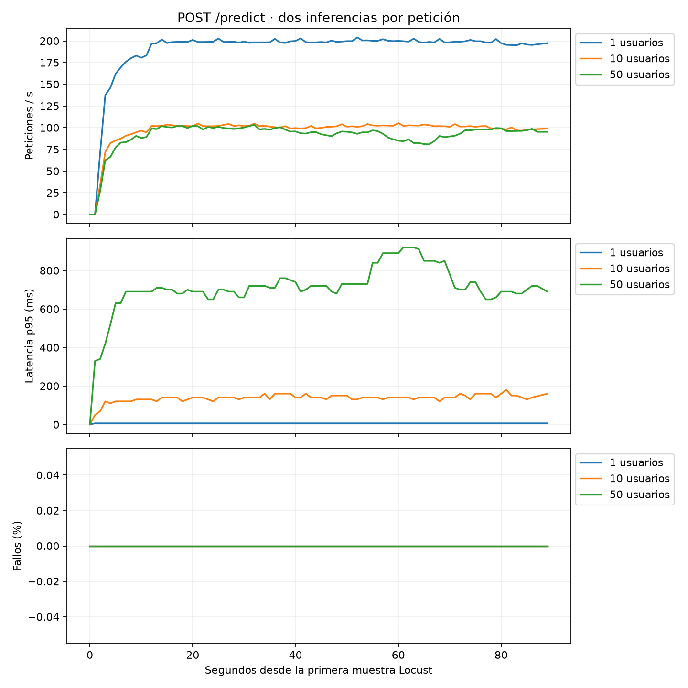
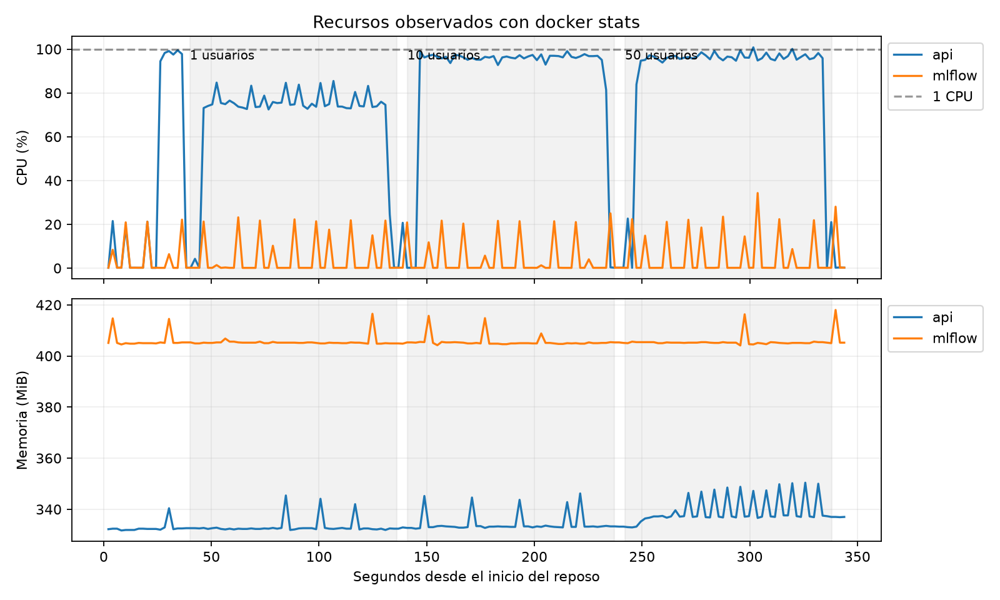

# P1 · Pruebas de carga y monitoreo de recursos

## Escenario y entorno

Ejecutamos Locust 2.47.0 el 22 de noviembre de 2026, de 12:45 a 12:50
(Ciudad de México), contra la API y MLflow levantados con Docker Compose.
El escenario usa el endpoint POST /predict con las dos instancias del ejemplo
público. Cada usuario espera la respuesta y envía la siguiente petición sin
pausa deliberada. Se valida HTTP 200, la identidad de modelo y dos predicciones
finitas no negativas en cada respuesta.

Los escenarios de 1, 10 y 50 usuarios se configuraron con 90 segundos cada uno,
en orden creciente, incluyendo su rampa de hasta cinco segundos. Previamente
se observaron 20 segundos de reposo y un calentamiento separado de 15 segundos
con dos usuarios. Las métricas globales de abajo provienen de los CSV finales
de Locust y excluyen el calentamiento. Se concedieron 15 segundos para que
terminaran las peticiones al cierre.

El host fue Ubuntu sobre WSL 2, AMD Ryzen 7 5700G, con ocho procesadores lógicos
y 13.60 GiB de RAM visibles en Linux. El generador y los servicios compartieron
ese host. Cada servicio tuvo una cuota de un CPU. API tuvo límite de 512 MiB
y MLflow, de 1 GiB. Docker fue 29.8.1 y Compose 5.5.1. El código de los servicios
corresponde a f11945b y el de medición a 009c153. Las identidades completas y
los hashes están en [metadata.json](metadata.json).

El modelo real fue P1 HGB Poisson de siete hojas, proveniente del run
01ec9f77835b4cf38601ef75cfd2375f de la entrega Docker. Compose lo importó
sin reentrenamiento como versión 1 en el run c10132c1778940da8313bf447c6dcaab.
La API devolvió la misma identidad y predicciones antes y después de las pruebas.

## 3. Resultados de Locust

| Usuarios | Peticiones | Peticiones/s | Inferencias exitosas/s | Media (ms) | p95 (ms) | p99 (ms) | Error |
|---:|---:|---:|---:|---:|---:|---:|---:|
| 1 | 17,452 | 198.95 | 397.89 | 4.93 | 6 | 8 | 0 % |
| 10 | 8,883 | 101.29 | 202.58 | 95.88 | 140 | 200 | 0 % |
| 50 | 8,374 | 95.48 | 190.97 | 508.11 | 720 | 890 | 0 % |

Se completaron 34,709 peticiones, equivalentes a 69,418 inferencias, con cero
fallos observados. La latencia máxima registrada fue de 57.21 ms, 285.70 ms
y 991.26 ms respectivamente. Los percentiles son aproximaciones del histograma
de Locust. Cada petición contiene dos inferencias y su latencia se mide por lote.

La concurrencia elevó la latencia sin aumentar el throughput. De 1 a 10 usuarios,
el throughput disminuyó aproximadamente 49.1 %. De 10 a 50 usuarios, bajó otro
5.7 % mientras la latencia media aumentó 5.3 veces. En el último escenario,
la serie muestra un tramo de menor throughput y mayor p95 alrededor del minuto
de ejecución. Una tasa de errores igual a cero coexistió con esperas mayores.

La carga cerrada mantiene usuarios en espera mientras la API procesa solicitudes.
Las cifras de throughput son el resultado observado bajo esa concurrencia y ese
lote fijo. Los resultados justifican investigar la contención al procesar varias
peticiones simultáneas. Para el próximo experimento conviene comparar cuotas
de CPU y número de procesos del servidor, manteniendo el mismo lote y protocolo,
y elegir la configuración por throughput y p95 a la vez.

Reportes nativos de Locust con sus gráficas

- [1 usuario](01-users1/locust.html)
- [10 usuarios](02-users10/locust.html)
- [50 usuarios](03-users50/locust.html)

## 4. CPU y memoria durante la prueba

Capturamos docker stats --no-stream durante reposo, calentamiento y carga. Cada
consulta produjo una muestra de ambos servicios aproximadamente cada dos segundos.
El archivo resources.csv conserva la hora de recepción y las unidades normalizadas.
Las medias de abajo incluyen el arranque y cierre del proceso Locust de cada escenario.

| Escenario | API CPU media / pico | API memoria media / pico (MiB) | MLflow CPU media / pico | MLflow memoria media / pico (MiB) |
|---|---:|---:|---:|---:|
| Reposo | 4.62 / 21.50 % | 332.13 / 332.40 | 3.40 / 20.91 % | 406.01 / 414.70 |
| 1 usuario | 68.78 / 85.45 % | 333.12 / 345.40 | 4.21 / 23.19 % | 405.41 / 416.50 |
| 10 usuarios | 89.87 / 99.07 % | 334.34 / 346.20 | 3.83 / 24.99 % | 405.53 / 415.70 |
| 50 usuarios | 89.08 / 100.80 % | 339.46 / 350.40 | 4.77 / 34.28 % | 405.38 / 416.30 |

En Docker, 100 % equivale a un núcleo. Durante los tramos activos de 10 y 50
usuarios, la API se mantuvo cerca de su cuota de un CPU. El pico muestreado de
100.80 % está próximo a esa cuota y refleja el cálculo por intervalo de Docker.
La coincidencia entre CPU alta, throughput estancado y latencia creciente es
compatible con una restricción de procesamiento o contención en la API.

La API alcanzó 350.4 MiB, aproximadamente 68.4 % de su límite. MLflow llegó
a 416.5 MiB durante los escenarios medidos, aproximadamente 40.7 % del suyo.
Ambos terminaron con cero reinicios y sin OOM. La memoria de la API creció
moderadamente en el escenario de mayor concurrencia. Este ensayo corto no
establece la evolución de memoria en operación prolongada.

MLflow mantuvo un consumo similar entre escenarios, coherente con la arquitectura
que carga el modelo localmente al arrancar la API. Los picos periódicos de CPU
también aparecen en reposo y son compatibles con los healthchecks del Compose.
Cambiar recursos de MLflow requiere validar también su carga de tracking y
artefactos, que no formó parte del tráfico de predicción de este ensayo.

El generador usó como máximo 24.5 % de un CPU y 57.88 MiB de RSS. Sus medias
fueron 22.26 %, 11.19 % y 10.70 % de CPU en orden de escenario. Estas muestras
no indican saturación de CPU del generador. Compartir WSL aún introduce
contención potencial con Windows y otros procesos del host.

## Alcance y entrega al análisis FinOps

Se realizó una repetición por escenario, con el mismo lote y orden creciente.
Los servicios ya habían pasado una prueba técnica corta antes de la corrida
formal. El reposo describe por tanto un sistema ya inicializado y calentado.
La prueba permite comparar esta configuración local. Las afirmaciones sobre
capacidad de producción o latencia objetivo requieren repeticiones, datos de
entrada representativos y un generador separado del servidor.

Para el punto 5, las inferencias exitosas/s de la tabla son el denominador
de throughput medido. Si la tarifa del sistema completo es P por hora,
el costo a ese nivel de utilización se estima como P / (3600 × inferencias/s).
El responsable de FinOps debe fijar proveedor, región y precio de referencia,
incluir los componentes del sistema y contemplar periodos ociosos. El costo
de construcción e inicialización se mide o amortiza por separado. Los límites
de memoria y CPU del Compose describen configuración y no consumo facturado.

La reproducción se documenta en [CARGA_RECURSOS_P1.md](../../../references/CARGA_RECURSOS_P1.md).
Los datos auditables están en [summary.csv](summary.csv),
[resource-summary.csv](resource-summary.csv), [generator-summary.csv](generator-summary.csv)
y [docker-stats.jsonl](docker-stats.jsonl). Los CSV originales permanecen
junto al HTML de cada escenario. El directorio warmup conserva el calentamiento
separado y permite comprobar su exclusión de la tabla.
