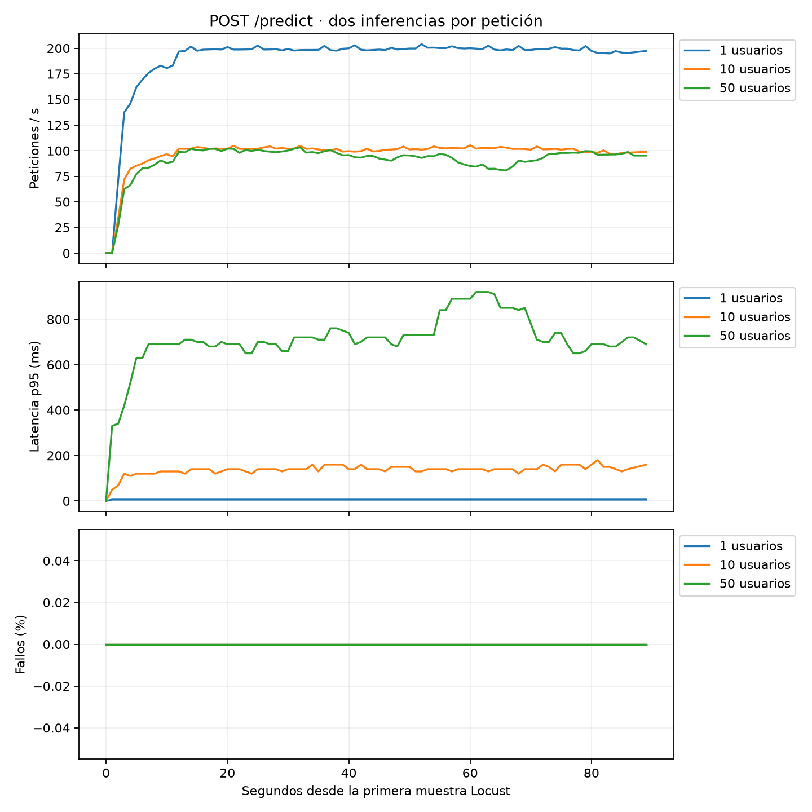
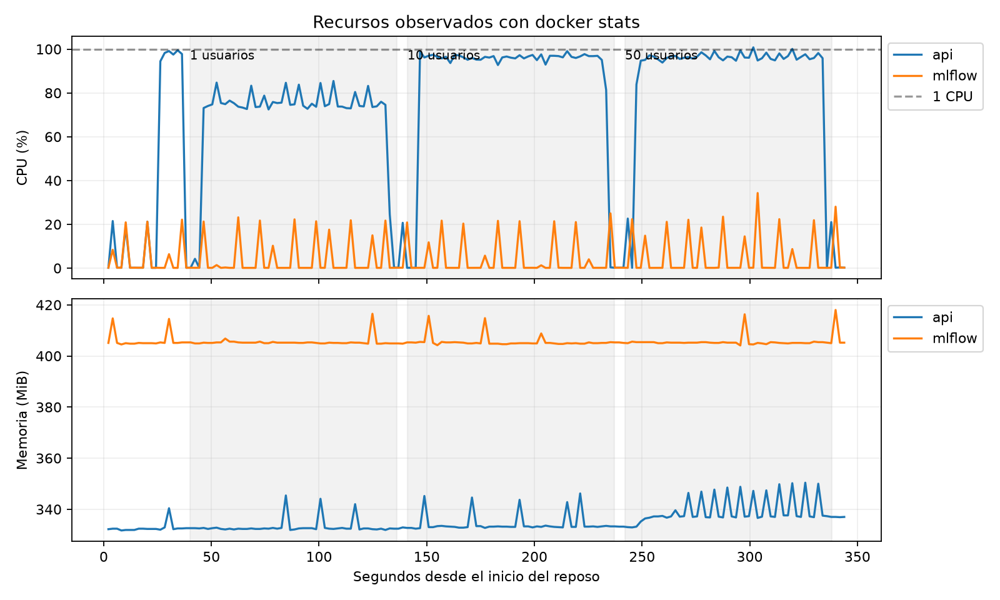

# Reporte de Pruebas de Carga y Análisis FinOps

**Proyecto:** MiBici - Equipo 13  
**Fecha de ejecución:** 22 de noviembre de 2026

---

# Objetivo

El objetivo de esta actividad fue evaluar el comportamiento del servicio de inferencia bajo distintos niveles de carga concurrente y analizar el consumo de recursos de la infraestructura para estimar el costo operativo del sistema.

Las pruebas permiten validar que la API desarrollada puede soportar un volumen creciente de solicitudes manteniendo niveles aceptables de desempeño, además de proporcionar información útil para la toma de decisiones relacionadas con costos y escalabilidad.

---

# Configuración de la prueba

Las pruebas de carga fueron ejecutadas mediante Locust utilizando el endpoint de predicción implementado para el modelo P1.

Se evaluaron tres escenarios de concurrencia:

| Escenario | Usuarios Concurrentes |
|------------|----------:|
| 01-users1 | 1 |
| 02-users10 | 10 |
| 03-users50 | 50 |

Durante cada ejecución se monitorearon:

- Solicitudes por segundo (Requests per Second).
- Latencia promedio.
- Percentiles de latencia (P50, P95 y P99).
- Tasa de error.
- Consumo de CPU.
- Consumo de memoria.

Adicionalmente se registraron métricas de consumo de recursos utilizando herramientas de monitoreo sobre los contenedores del sistema.

---

# Resultados de desempeño

## Rendimiento general

| Escenario | Usuarios | Requests/s | Latencia Promedio (ms) | P95 (ms) | Errores (%) |
|------------|----------:|----------:|----------:|----------:|----------:|
| 01-users1 | 1 | 198.95 | 4.93 | 6.0 | 0.0 |
| 02-users10 | 10 | 101.29 | 95.88 | 140.0 | 0.0 |
| 03-users50 | 50 | 95.48 | 508.11 | 720.0 | 0.0 |

Los resultados muestran que el servicio mantiene una tasa de error del 0% en todos los escenarios evaluados.

La mayor capacidad observada fue de aproximadamente 199 solicitudes por segundo bajo carga ligera. Conforme aumenta la concurrencia, la latencia se incrementa de forma progresiva, aunque el sistema mantiene una capacidad superior a 95 solicitudes por segundo incluso con 50 usuarios concurrentes.

---

## Gráfica de desempeño



La gráfica de desempeño muestra la relación entre concurrencia, latencia y throughput durante las pruebas realizadas.

---

# Consumo de recursos

## Servicio API

| Escenario | CPU Promedio (%) | CPU Máximo (%) | Memoria Promedio (MiB) |
|------------|----------:|----------:|----------:|
| Reposo | 4.62 | 21.50 | 332.13 |
| 1 usuario | 68.78 | 85.45 | 333.12 |
| 10 usuarios | 89.87 | 99.07 | 334.34 |
| 50 usuarios | 89.08 | 100.80 | 339.46 |

## Servicio MLflow

| Escenario | CPU Promedio (%) | CPU Máximo (%) | Memoria Promedio (MiB) |
|------------|----------:|----------:|----------:|
| Reposo | 3.40 | 20.91 | 406.01 |
| 1 usuario | 4.21 | 23.19 | 405.41 |
| 10 usuarios | 3.83 | 24.99 | 405.53 |
| 50 usuarios | 4.77 | 34.28 | 405.38 |

---

## Gráfica de uso de recursos



Los resultados indican que la mayor carga computacional recae sobre la API de inferencia.

Mientras el consumo de CPU de la API alcanza aproximadamente el 90% bajo carga alta, el servidor de MLflow mantiene un comportamiento estable con una utilización inferior al 5% en promedio.

Por otro lado, el consumo de memoria se mantiene prácticamente constante durante todos los escenarios, evidenciando que el modelo permanece cargado en memoria y que las solicitudes adicionales no generan crecimiento significativo en el uso de RAM.

---

# Análisis FinOps

## Observaciones principales

Desde una perspectiva de costos operativos, los resultados obtenidos son favorables.

El sistema logró sostener aproximadamente:

```text
95.48 solicitudes por segundo
```

en el escenario más exigente evaluado, manteniendo una tasa de error nula.

La infraestructura utilizada demostró una utilización eficiente de memoria y una alta utilización de CPU únicamente en el servicio de inferencia.

---

## Supuesto de infraestructura

Para realizar una estimación simplificada del costo operativo se tomó como referencia una instancia equivalente a:

- 2 vCPU
- 4 GB de memoria RAM

Costo aproximado:

```text
USD $0.0416 por hora
```

---

## Estimación de costo por inferencia

En el escenario de mayor carga:

```text
95.48 solicitudes/segundo
```

Lo anterior equivale a:

```text
95.48 × 3600
=
343,728 solicitudes por hora
```

Por lo tanto:

```text
Costo por inferencia
=
0.0416 / 343,728
=
0.000000121 USD
```

Costo aproximado:

```text
USD $0.000000121 por inferencia
```

o

```text
0.0000121 centavos de dólar por inferencia
```

---

## Evaluación económica

Los resultados permiten concluir que el servicio presenta un costo unitario extremadamente bajo.

Incluso considerando crecimientos moderados de tráfico, la infraestructura evaluada sería suficiente para soportar una carga significativamente mayor antes de requerir escalamiento horizontal.

Esto convierte a la solución en una alternativa económicamente viable para desplegar modelos predictivos relacionados con la demanda de estaciones MiBici.

---

# Recomendaciones de optimización

A partir de los resultados obtenidos se recomiendan las siguientes acciones:

1. Mantener una sola instancia para cargas bajas o moderadas.
2. Mantener el modelo precargado en memoria para evitar costos de inicialización.
3. Continuar monitoreando la utilización de CPU como principal indicador de saturación.
4. Implementar escalamiento horizontal únicamente cuando la utilización de CPU permanezca cercana al 100% durante periodos prolongados.
5. Repetir periódicamente las pruebas de carga para identificar cambios en el comportamiento del sistema conforme evolucionen los modelos y los patrones de uso.

---

# Conclusiones

Las pruebas de carga demostraron que el servicio es capaz de procesar solicitudes de inferencia de manera estable y sin errores incluso bajo escenarios de alta concurrencia.

La API mantuvo una disponibilidad del 100% durante las pruebas realizadas y alcanzó una capacidad superior a 95 solicitudes por segundo con 50 usuarios concurrentes.

El análisis de recursos identificó que la API constituye el principal consumidor de CPU, mientras que el servidor de MLflow mantiene una utilización mínima y estable.

Desde una perspectiva FinOps, el costo estimado por inferencia resulta extremadamente bajo, lo que respalda la viabilidad económica de la solución propuesta.

En conjunto, los resultados indican que la arquitectura implementada ofrece un equilibrio adecuado entre desempeño, estabilidad y costo operativo, cumpliendo satisfactoriamente los objetivos establecidos para esta etapa del proyecto.