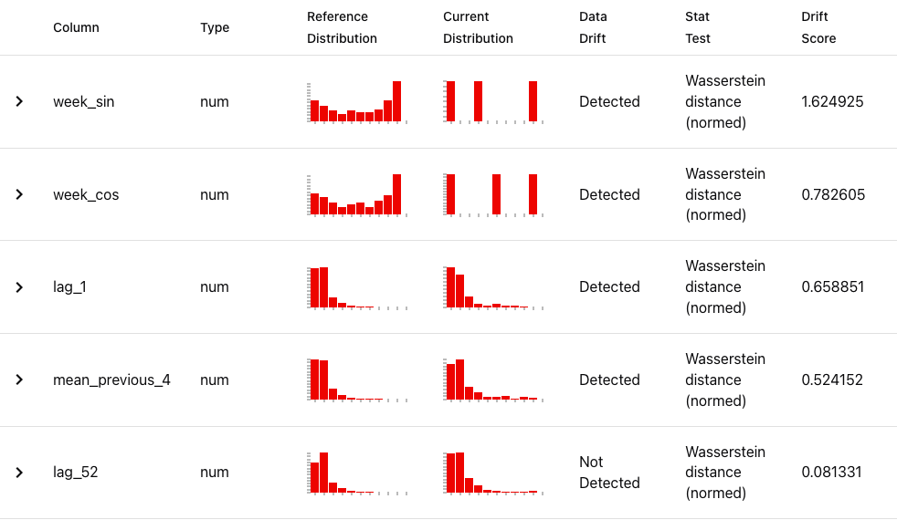
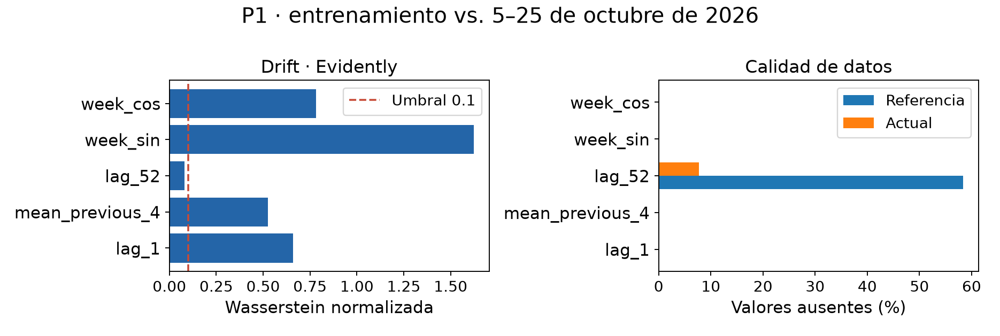

# Reporte de Drift y A/B Testing

**Equipo 13**

- Daniel Salinas Romero
- Diego Armando Vázquez Calderón
- José Alberto Velázquez Trujillo

---

# Objetivo del monitoreo

Una vez desplegado un modelo de aprendizaje automático, es necesario verificar que los datos observados en producción continúen siendo consistentes con aquellos utilizados durante el entrenamiento. Cuando las distribuciones cambian significativamente, el modelo puede perder capacidad predictiva y requerir actualización.

Con este propósito se realizó un análisis de drift utilizando Evidently y posteriormente un A/B testing entre dos versiones del modelo para determinar si una nueva versión ofrece ventajas respecto al modelo actualmente vigente.

---

# Metodología utilizada

Se comparó un conjunto de referencia correspondiente al periodo utilizado durante el entrenamiento contra un conjunto más reciente que representa el comportamiento actual del sistema MiBici.

Para la detección de drift se utilizó Evidently con métricas basadas en distancia de Wasserstein, empleando un umbral de referencia de 0.1 para identificar variables con cambios significativos en su distribución.

Adicionalmente, se evaluaron dos versiones del modelo utilizando el mismo conjunto de prueba para comparar su desempeño mediante las métricas:

- MAE (Mean Absolute Error)
- RMSE (Root Mean Squared Error)
- WAPE (Weighted Absolute Percentage Error)

---

# Interpretación de los resultados de Data Drift

El análisis de drift realizado mediante Evidently comparó el conjunto de referencia utilizado durante el entrenamiento del modelo contra un conjunto más reciente que representa el comportamiento actual del sistema MiBici.

Los resultados indican que 4 de las 5 variables monitoreadas presentan drift significativo (80% de las variables analizadas), lo que evidencia cambios importantes entre el entorno de entrenamiento y el entorno actual.

| Variable | Drift |
|-----------|---------:|
| lag_1 | 0.6589 |
| mean_previous_4 | 0.5242 |
| lag_52 | 0.0813 |
| week_sin | 1.6249 |
| week_cos | 0.7826 |

Las variables con mayor drift fueron `week_sin`, `week_cos`, `lag_1` y `mean_previous_4`.

Los cambios observados en `week_sin` y `week_cos` sugieren diferencias importantes en los patrones estacionales presentes en los datos recientes respecto a los utilizados durante el entrenamiento. Esto puede indicar variaciones temporales en el uso del sistema, cambios en hábitos de movilidad o diferencias entre temporadas.

Por otra parte, el drift observado en `lag_1` y `mean_previous_4` indica que la demanda reciente de viajes presenta una distribución distinta a la observada históricamente. Dado que estas variables tienen un peso importante en la predicción de demanda semanal, los cambios detectados podrían afectar directamente el desempeño predictivo del modelo.

La variable `lag_52` fue la única que no presentó drift significativo, lo que sugiere que los patrones anuales históricos mantienen cierta estabilidad.

Respecto a la calidad de los datos, no se detectaron filas duplicadas, columnas vacías ni columnas constantes. Únicamente se observó una pequeña proporción de valores faltantes en `lag_52` (7.69%), lo cual no representa un problema crítico para el monitoreo realizado.

En conjunto, los resultados muestran evidencia clara de que el entorno de producción ha evolucionado respecto al conjunto utilizado para entrenamiento, por lo que resulta recomendable mantener un monitoreo continuo y evaluar periódicamente la necesidad de reentrenamiento.

---

# Implicaciones operativas para MiBici

Los cambios observados en las variables de demanda sugieren que el comportamiento actual de las estaciones difiere del que fue utilizado para entrenar el modelo inicialmente.

Si estos cambios continúan incrementándose, el error de predicción podría aumentar, afectando decisiones de operación como:

- Redistribución de bicicletas.
- Planeación de mantenimiento.
- Identificación de estaciones con alta demanda.
- Asignación eficiente de recursos operativos.

Por esta razón, el monitoreo de drift debe considerarse una actividad permanente dentro del ciclo de vida del modelo.

---

# Capturas del reporte

## Evidently HTML

## Distribuciones y variables con drift

---

# Resultados del A/B Testing

Se compararon dos versiones del modelo utilizando el mismo conjunto de evaluación correspondiente al periodo actual.

| Modelo | Versión | MAE | RMSE | WAPE |
|----------|----------|----------:|----------:|----------:|
| A | 1 | 23.6230 | 39.6640 | 0.1394 |
| B | 2 | 23.9444 | 40.0641 | 0.1413 |

Los resultados muestran que la versión A mantiene un desempeño ligeramente superior en las tres métricas utilizadas para evaluación.

La diferencia es pequeña, pero consistente:

- Menor MAE.
- Menor RMSE.
- Menor WAPE.

Por esta razón, no se observa un beneficio claro al promover la versión B como sustituta del modelo actualmente vigente.

---

# Interpretación del A/B Testing

Aunque el análisis de drift detectó cambios importantes en los datos de entrada, la nueva versión del modelo no logró superar al modelo actual durante la evaluación.

Este resultado demuestra que la presencia de drift no implica necesariamente que un nuevo modelo sea mejor. La decisión de actualización debe fundamentarse tanto en el análisis de los datos como en métricas objetivas de desempeño.

En este caso, la versión vigente continúa ofreciendo mejores resultados sobre el conjunto actual de evaluación.

---

# Recomendación de Continuous Training

Con base en los resultados obtenidos, se recomienda:

1. Mantener la versión A como modelo productivo.
2. Continuar registrando y monitoreando datos recientes.
3. Ejecutar análisis periódicos de drift utilizando Evidently.
4. Reentrenar el modelo cuando el drift persista o se observe degradación en las métricas de desempeño.
5. Validar futuras versiones mediante A/B testing antes de promoverlas a producción.

---

# Conclusiones

El monitoreo realizado permitió identificar drift significativo en 4 de las 5 variables utilizadas por el modelo, principalmente en aquellas relacionadas con estacionalidad y demanda reciente.

Sin embargo, el análisis A/B mostró que la nueva versión entrenada no supera al modelo actualmente desplegado, por lo que no existe evidencia suficiente para justificar un cambio inmediato de versión.

La recomendación final consiste en mantener el modelo vigente, continuar monitoreando el comportamiento del sistema MiBici y reevaluar la necesidad de reentrenamiento conforme se acumulen nuevos datos de operación.